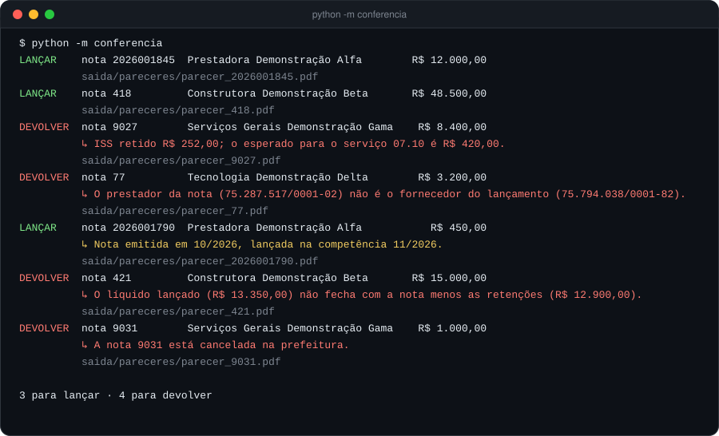
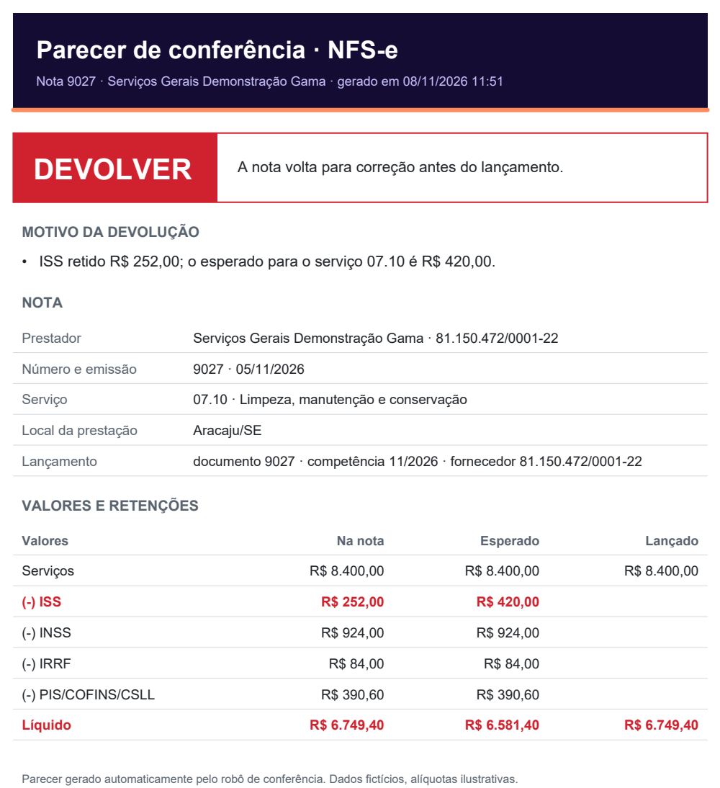

<h1 align="center">Conferência de NFS-e</h1>

<p align="center">
  <b>Robô que confere notas fiscais de serviço contra o lançamento no ERP e devolve um parecer em PDF: lançar ou devolver, e por quê.</b>
</p>

<p align="center">
  
  
  
  
</p>

---

## O problema

Toda nota de serviço lançada no ERP precisa ser conferida antes do pagamento: prestador, número, valor e, principalmente,
as **retenções** (ISS, INSS, IRRF e PIS/COFINS/CSLL). Feito à mão, é lento, cansativo e o erro só aparece depois,
como multa ou como pagamento a mais.

## A solução

O robô lê a nota e o lançamento, aplica as regras e decide sozinho. O parecer vai direto ao ponto: **a decisão e o
motivo** primeiro, os dados da nota depois, com a linha que diverge em vermelho.

<p align="center"></p>

<p align="center"></p>

## Regras

| Regra | Bloqueia ou avisa |
|---|---|
| Nota cancelada na prefeitura | bloqueia |
| CNPJ do prestador inválido ou diferente do fornecedor lançado | bloqueia |
| Número da nota diferente do documento lançado | bloqueia |
| Emissão no futuro | bloqueia |
| Emissão fora da competência do lançamento | avisa |
| Valor dos serviços diferente do lançado | bloqueia |
| ISS pela alíquota do município da prestação | bloqueia |
| INSS de 11% em serviço com cessão de mão de obra | bloqueia |
| IRRF e PIS/COFINS/CSLL pelo código do serviço, com dispensa até R$ 10,00 | bloqueia |
| Líquido lançado = nota menos as retenções | bloqueia |

As alíquotas ficam em [`conferencia/regras.json`](conferencia/regras.json). **Os valores do repositório são
ilustrativos**; confira sempre a legislação do seu município e do seu regime.

Os CNPJs das notas de exemplo têm dígito verificador válido e foram conferidos como **inexistentes** nas bases
públicas da Receita, para que nenhuma empresa real apareça associada às irregularidades inventadas da demonstração.

## Rodando

```bash
git clone https://github.com/EdyVerder/conferencia-nfse.git
cd conferencia-nfse
python -m pip install -r requirements.txt
python -m conferencia                     # confere dados/notas_ficticias.json e gera saida/pareceres/*.pdf
python -m pytest -q                       # 12 testes
```

## Na produção

A versão real lê **tudo direto do banco do ERP** (nota importada, lançamento, tributos e anexos), sem depender
de tela, e manda o parecer por e-mail para quem lançou. A decisão de cada caso fica registrada para auditoria.

## Estrutura

```
conferencia/
  regras.py      Nota, Lançamento, as regras e a decisão (puro, testável)
  regras.json    alíquotas por município e por código de serviço
  parecer.py     PDF do parecer
  __main__.py    linha de comando
dados/
  notas_ficticias.json   7 casos: certos, retenção errada, fornecedor trocado, líquido errado, nota cancelada
tests/
```

---

<p align="center"><sub>Feito por <a href="https://github.com/EdyVerder">Rocha</a> · empresas e CNPJs fictícios · licença MIT</sub></p>
